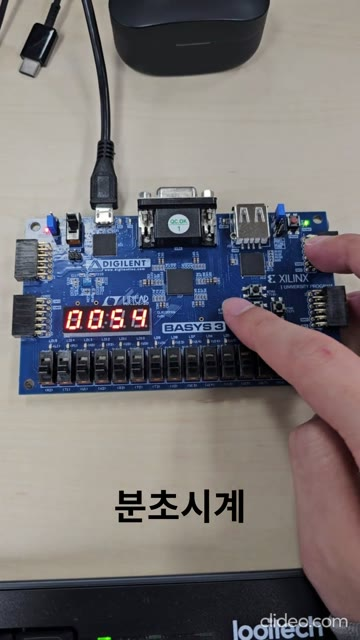

# Basys3 Clock & Stopwatch

**Verilog HDL · Basys3 (Artix-7) · Vivado 2026.1**

4자리 7-Segment에 분초 시계와 10 ms 해상도 스톱워치를 구현한 FPGA 학습 프로젝트입니다.
버튼 입력 처리부터 모드 FSM, 시간 계수, 화면 스캔까지 RTL 모듈로 구성했습니다.

[▶ 25초 보드 시연](docs/assets/demo.mp4) · [FSM 및 테스트 분석](docs/verification.md)

<a href="docs/assets/demo.mp4"></a>

## 주요 동작

| 기능 | 동작 |
|---|---|
| 분초 시계 | `MM.SS`, 59:59 → 00:00 순환, Dot 1 Hz 점멸 |
| 스톱워치 | `SS.hh`, 10 ms마다 증가, 99.99초 → 00.00초 순환 |
| 일시정지 | 시간 보존, 5초 무입력 시 FND 바깥 선분 회전 |
| 버튼 입력 | 애니메이션 종료와 선택한 기능을 함께 수행 |

`12.34`는 시계에서 **12분 34초**, 스톱워치에서 **12초 340 ms**입니다.
분초 시계는 화면과 무관하게 계속 진행하며, 스톱워치는 실행 모드에서만 진행합니다.

| 입력 | 기능 |
|---|---|
| 왼쪽 `btn[0]` | 시계 ↔ 스톱워치 전환, 스톱워치 진입 시 실행 |
| 가운데 `btn[1]` | 스톱워치 초기화, 실행/일시정지 상태 유지 |
| 오른쪽 `btn[2]` | 스톱워치 실행 ↔ 일시정지 |
| SW15 | 전체 리셋 |

## 설계

- **100 MHz 단일 클럭**: 1 ms tick을 동작 허가 신호로 사용
- **입력 안정화**: 2단 동기화, 10 ms 디바운스, 상승 에지 펄스 생성
- **기능 분리**: 모드 FSM, 독립 시간 카운터, FND 표시 및 애니메이션 모듈
- **리셋**: 비동기 인가와 동기 해제

[RTL 소스](fpga_stopwatch.srcs/sources_1/new/) · [테스트벤치](fpga_stopwatch.srcs/sim_1/new/) · [Basys3 핀 제약](fpga_stopwatch.srcs/constrs_1/new/basys3.xdc)

## 실행 및 검증

Vivado 2026.1에서 `fpga_stopwatch.xpr`을 열고, `top_minsec_stopwatch`를 합성 Top으로 사용합니다.
일괄 검증은 Vivado 실행 경로가 설정된 터미널에서 저장소 루트를 기준으로 실행합니다.

```powershell
vivado -mode batch -source scripts/verify_project.tcl
```

테스트벤치 **2개 PASS**, 합성·배치배선·비트스트림 생성 완료, DRC 오류 **0개**입니다.
100 MHz 제약 기준 WNS는 **+4.224 ns**이며, 재현 방법과 타이밍 차트는 [검증 문서](docs/verification.md)에 정리했습니다.
로그·파형·비트스트림 등 생성물은 저장소에서 제외합니다.

## 출처

핀 제약은 [Digilent Basys3 Master XDC](https://github.com/Digilent/digilent-xdc/blob/master/Basys-3-Master.xdc)를 이 설계의 포트에 맞게 사용했습니다.
수업 과제를 바탕으로 기능·검증·문서를 보완했으며, AI 도구를 코드 검토와 문서화에 보조적으로 활용했습니다.
