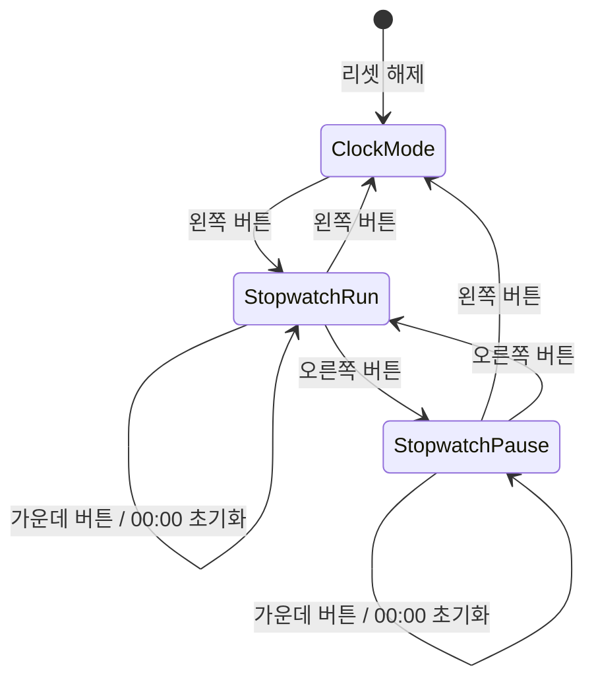

# 설계 및 검증 노트

## 동작 상태

왼쪽 버튼이 가장 높은 우선순위이며, 이어서 가운데, 오른쪽 순서입니다. 분초 시계는 백그라운드에서 계속 계수합니다. 스톱워치는 시계 화면이나 일시정지 상태에서 계수값을 보존합니다. 일시정지 중 가운데 버튼은 스톱워치 시간을 초기화하지만 일시정지는 유지합니다.

## 시간 생성 및 표시

100 MHz에서 100,000클럭을 세어 1 ms tick을 생성합니다. 1,000개의 tick으로 1초를 만들고, 60초마다 분을 올립니다. 시계 Dot은 밀리초 계수값이 0~499일 때 켜고, 500~999일 때 꺼서 1초 주기로 점멸합니다. 스톱워치 표시의 Dot은 계속 켜져 있습니다.

Basys3 4자리 FND에는 콜론이 없어 Dot으로 분과 초를 구분합니다. 예를 들어 1분 23초는 `01.23`으로 나타납니다. 두 시간 카운터는 59:59 다음 00:00으로 순환합니다.

## 무입력 애니메이션

스톱워치가 일시정지되고 버튼을 모두 놓은 뒤 5,000개의 1 ms tick이 지나면 애니메이션이 시작됩니다. FND 바깥 선분 a→b→c→d→e→f를 각각 100 ms 간격으로 순환합니다. 버튼 입력이 디바운스된 뒤 애니메이션 표시를 종료하고 기존 버튼 기능을 수행합니다. 버튼을 누른 채로 있는 동안에는 대기 시간을 누적하지 않습니다.

최상위 파라미터 `IdleTimeMs`와 `AnimationStepMs`로 대기 시간과 회전 간격을 조정할 수 있습니다.

## 시뮬레이션 결과

| 테스트벤치 | 확인 내용 | 결과 |
|---|---|---|
| `tb_top_minsec_stopwatch` | 한 시간 순환, 1 ms 분주, 버튼 상태·우선순위, FND Dot 위상과 모드별 출력 | PASS |
| `tb_fnd_idle_animation` | 5초 대기, 100 ms 회전, 버튼 입력 및 초기화 우선순위 | PASS |
| `tb_display_and_boundaries` | 0000~9999의 네 자리 디코딩, 최소 분주 파라미터, 리셋 동기화 | PASS |

시뮬레이션은 Verilog 동작을 확인한 결과이며 실제 FPGA 보드의 전기적·시각적 동작을 대신하지 않습니다.

## 구현 결과

- 타깃: Basys3 `xc7a35tcpg236-1`
- 내부 100 MHz 타이밍: WNS +3.444 ns, WHS +0.131 ns, 제약된 경로 위반 0개
- 자원: LUT 383개 (1.84%), 플립플롭 163개 (0.39%), 래치 0개
- DRC 오류: 0개
- 실제 보드 다운로드 시험: 미실시

입출력 지연 제약이 없어 Vivado TIMING-18 보고서에 외부 지연 경고가 남습니다. 이 보고서의 내부 타이밍 충족을 외부 I/O 경로의 타이밍 보증으로 해석하지 않습니다.
