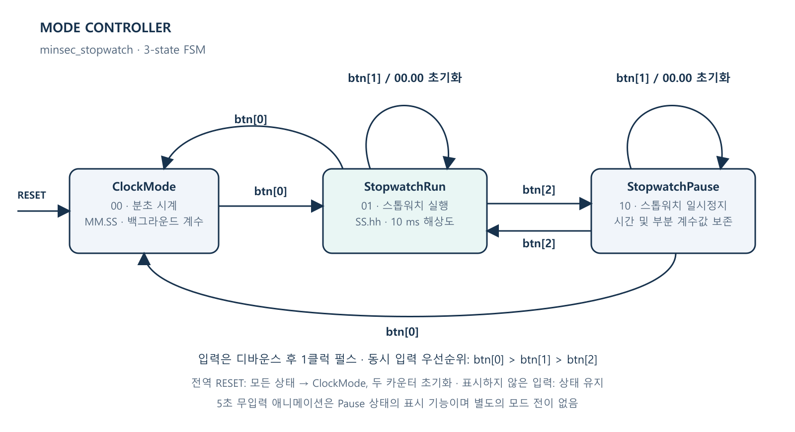
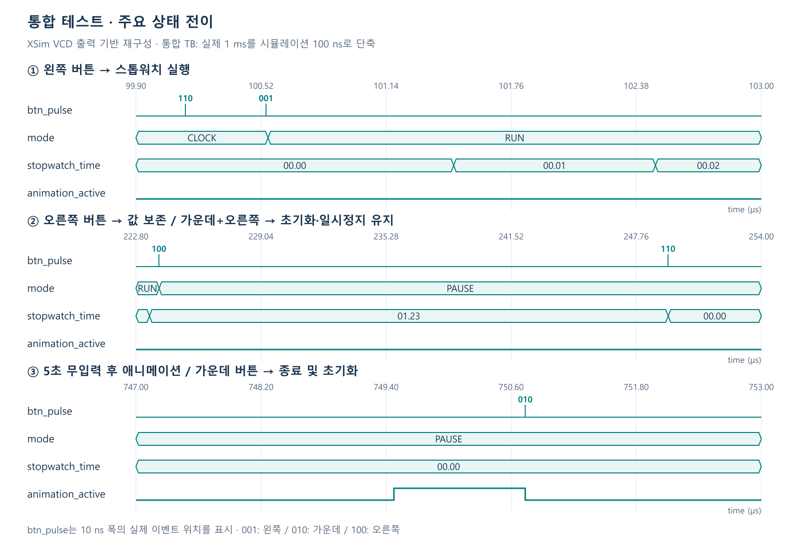
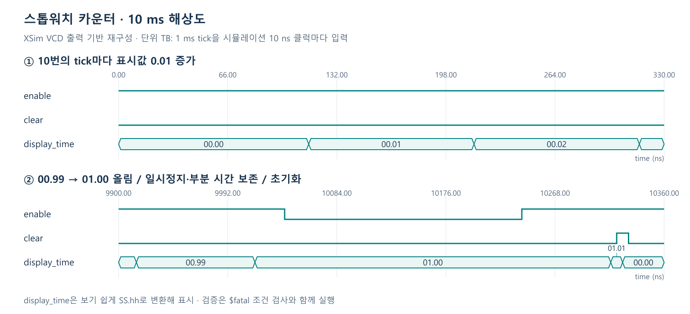

# 설계 및 검증

## 모드 FSM



버튼은 디바운스 후 1클럭 펄스로 처리합니다. 동시 입력은 **왼쪽 > 가운데 > 오른쪽** 순서입니다.
전역 리셋은 어느 상태에서든 시계 모드로 복귀하고 두 카운터를 초기화합니다.
애니메이션은 일시정지 상태의 화면 효과이며 별도의 모드가 아닙니다.

- 분초 시계는 항상 계수, 스톱워치는 시계 화면과 일시정지 상태에서 부분 시간까지 보존
- 가운데 버튼은 스톱워치만 초기화, 현재 실행/일시정지 상태 유지
- 시계에서 스톱워치로 재진입하면 보존한 값에서 실행
- 버튼을 모두 놓은 뒤 5초가 지나면 애니메이션, 누른 채로 있으면 대기 시간 초기화

시간 경로는 `100 MHz → 100,000클럭 → 1 ms tick`입니다.
시계는 1,000 tick마다 1초를 올리고, 스톱워치는 10 tick마다 1/100초를 올립니다.
FND는 1 ms마다 한 자리를 선택하며 한 화면의 갱신 주기는 4 ms입니다.

## 테스트벤치와 타이밍 분석

발표에서는 **입력 → 상태 전이 → 시간 값 → 화면 효과** 순서로 설명할 수 있도록 테스트 2개로 구성했습니다.

| 테스트벤치 | 주요 확인 항목 | 결과 |
|---|---|---|
| [tb_top_minsec_stopwatch](../fpga_stopwatch.srcs/sim_1/new/tb_top_minsec_stopwatch.v) | 모드 전환, 일시정지·초기화, 무입력 애니메이션, 버튼 우선순위, 전역 리셋 | PASS |
| [tb_stopwatch_counter](../fpga_stopwatch.srcs/sim_1/new/tb_stopwatch_counter.v) | 10 ms 해상도, 1초 올림, 부분 시간 보존, 99.99초 순환 | PASS |

### 발표용 핵심 코드

아래 부분은 일시정지 중 시간이 유지되는지, 가운데+오른쪽 버튼을 함께 눌러도 초기화가 우선되는지 확인합니다.

```verilog
saved_time = stopwatch_time;
wait_ms(250);
if (stopwatch_time !== saved_time)
  $fatal(1, "paused time changed");
press_button(3'b110);
if (mode !== 2 || stopwatch_time !== 0)
  $fatal(1, "clear must preserve pause");
```

### 통합 동작



| 구간 | 분석 |
|---|---|
| ① 모드 전환 | 왼쪽 버튼 펄스 후 `CLOCK → RUN`, 스톱워치 값 증가 |
| ② 일시정지·초기화 | 오른쪽 버튼으로 `PAUSE`, 값 유지 후 가운데 버튼으로 00.00 초기화 |
| ③ 애니메이션 | 5초 무입력 후 활성화, 가운데 버튼 인식 시 종료하며 상태는 `PAUSE` 유지 |

### 10 ms 시간 계수



10개의 tick마다 표시값이 0.01 증가합니다. `00.99 → 01.00`에서 초 자리로 올림하고,
`enable=0`인 구간은 계수하지 않습니다. 재개 시 10 ms 미만의 부분 시간까지 이어서 계수합니다.

위 이미지는 **실제 XSim VCD 출력을 재구성한 타이밍 차트**입니다. GUI 화면 캡처는 아닙니다.
통합 TB는 1 ms를 100 ns로, 카운터 TB는 1 ms tick을 10 ns로 가속했습니다.
따라서 그림의 가로축은 시뮬레이션 시간이며 실제 보드의 경과 시간과 구분합니다.

PPT에 XSim 화면을 직접 캡처하려면 해당 TB를 Simulation Top으로 선택해 Run All을 실행합니다.
통합 TB의 `mode`, `btn_pulse`, `stopwatch_time`, `animation_active`를 중심으로 보면 됩니다.
일괄 검증은 핵심 신호만 포함한 `verification/<tb>.wcfg`와 VCD도 생성합니다.

## 구현 결과

Vivado 2026.1, Basys3 `xc7a35tcpg236-1`, 100 MHz 기준으로 다른 경로의 복사본에서 검증했습니다.

| 항목 | 결과 |
|---|---|
| 합성 / 배치배선 / 비트스트림 | 성공 |
| 타이밍 | WNS +4.224 ns / WHS +0.122 ns |
| 자원 | LUT 437개 (2.10%) / FF 159개 (0.38%) |
| DRC 오류 / 래치 / 미해결 모듈 | 모두 0개 |

[보드 시연 영상](assets/demo.mp4)에서 모드 전환·일시정지·애니메이션·재개·초기화를 확인했습니다.
영상은 최종 버튼 연결 수정 이전 촬영본이며, 최종 수정본의 보드 재다운로드 시험은 별도로 필요합니다.
외부 I/O 지연 제약이 없어 TIMING-18 경고 32건이 남습니다. 위 타이밍 결과는 제약된 경로 기준입니다.

## 소스 등록 문제 해결

프로젝트를 열어둔 상태에서 파일 구성이 바뀌면 닫았다가 `fpga_stopwatch.xpr`을 다시 엽니다.
모듈 누락 오류가 남으면 Vivado Tcl Console에서 아래 명령으로 소스를 다시 등록합니다.

```tcl
source [file join [get_property DIRECTORY [current_project]] scripts register_sources.tcl]
```

PNG는 PPT 삽입용이며, [FSM SVG](assets/fsm.svg)와 [블록도 SVG](assets/function_block_diagram.svg)는 확대·편집용 원본입니다.
